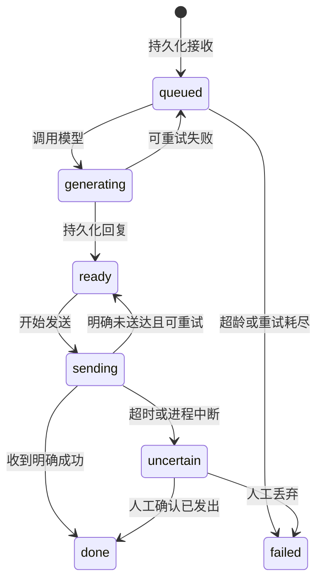

# 历史原生协议与既有服务说明

本文件保留先前实现和运维文档。当前默认官方内核路线请阅读项目 README 和 KERNEL.md。

# QQ AI Bot — 自研原生 QQ 驱动与 AI 机器人

从零编写的 Node.js 24 项目：OneBot v11 服务、可替换 QQ 底层接口、AI 回复和 SQLite 持久化队列。**按你选择的独立底层路线，不依赖 NapCat，也没有复用其 QQ 内核。**

**新增实验性 `native` 原生协议驱动**：直接连接 QQ TCP 网关，自行实现 SSO 封包、P-256 ECDH、QQ TEA、Protobuf/TLV、扫码认证、会话注册和文本消息收发代码。二维码必须来自服务器响应。尚未完成真实账号扫码与收发验收；合成协议端测试通过不代表当前 QQ 服务端接受这些请求。`demo` 仍仅供模拟。

## 启动

需要 Node.js **24 或更高版本**（使用内置 `node:sqlite`）。唯一 npm 运行依赖为 `ws`，版本由 lockfile 固定。

```powershell
cd D:\ai\Codex\qq-ai-bot
npm ci
npm run init
npm start
```

`init` 生成 `.env`，包含独立的 OneBot/管理员 Token 和会话加密密钥；升级已有配置时只补充或修正管理员密钥，保留其他设置。默认监听 `127.0.0.1:5700`。另外开一个终端：

```powershell
npm run cli -- status
npm run cli -- login
```

默认使用 `native`，首次启动 `online=false`。先在 `.env` 配置可信、版本匹配的 `QQ_SIGN_URL`，必要时填写 `QQ_SIGN_TOKEN`；未配置时 `login` 明确返回 `1501`。内置研究参数为 Linux `3.2.26-46494`，不是“保证可登录的最新版本”；可用 `QQ_PROFILE` 指定匹配签名服务的 JSON。详见 [原生协议使用及验证记录](NATIVE.md)。保留 `SESSION_KEY`，否则保存的会话无法解密。

```powershell
npm run native:check -- --connect
npm run cli -- login --wait
# 真实服务端返回二维码后，CLI 保存到 data/qrcode.png；用手机 QQ 扫码确认。
npm run cli -- friends
npm run cli -- groups
npm run cli -- watch 60
npm run cli -- send 目标QQ号 "你好"
npm run cli -- send-group 目标群号 "你好"
```

`native:check --connect` 只检查配置与 TCP 可达性，不认证或发送消息。`watch` 打印实际收到的消息。`logout` 断开连接并删除本机会话，不宣称撤销服务器上的所有登录授权。已有 `.env` 不会被 `init` 更新，旧配置需把 `QQ_DRIVER=scaffold` 改为 `native` 并添加签名配置。

## 可立即运行的演示

```powershell
npm run demo
```

演示创建临时数据库、模拟 QQ 驱动和本地 AI 替身，通过实际 HTTP 接口注入消息，等待回复后查询发送结果，最后清理临时数据。输出明确带 `simulated: true` 和 `real_qq: false`。不会访问 QQ 或调用外部 AI。

持续运行模拟服务：把 `.env` 的 `QQ_DRIVER` 改为 `demo`，然后 `npm start`。AI 默认关闭；以下命令仅模拟发送和接收：

```powershell
npm run cli -- send 10001 "模拟发送"
npm run cli -- inject 1 10001 "模拟收到一条消息"
npm run cli -- jobs
```

## 当前实现边界

| 模块 | 当前能力 |
| --- | --- |
| QQ 核心 | 实验性原生 SSO/WtLogin 扫码驱动；自研编解码，无 NapCat 或其它 QQ 协议库运行依赖；待真实账号验收 |
| 原生能力 | 扫码状态、加密票据恢复、心跳、私聊/群聊文本、可解析 UID 的群 @、好友/群列表、持久消息缓存 |
| 驱动基础设施 | AES-256-GCM 加密会话、原生消息 ID 到 OneBot int32 的持久化映射、可取消 RPC 超时、受控重连入口 |
| OneBot v11 传输 | HTTP GET/POST、表单/JSON、正向 WS `/` `/api` `/event`、Universal 反向 WS、HTTP 事件上报 |
| OneBot API | 已有路由和参数映射；具体业务是否可用取决于 QQ 驱动，见兼容表 |
| AI | Chat Completions 兼容接口、会话上下文、用户/群白名单、群聊 @ 触发、纯文本输出 |
| 稳定性 | SQLite WAL、消息去重、发送前持久化回复、重启恢复、生成重试、发送限速、积压上限、发送未知状态人工核对 |
| 运行 | 单数据目录单实例、健康探针、结构化日志、CLI、Docker 部署文件 |

原生驱动暂不支持密码登录、二次验证提交、离线消息同步、撤回、图片/语音和群管理；未实现能力明确失败。设备验证由用户正常完成。真实 QQ 兼容性和长期可用性仍需实测。

## 接入自己的 QQ 核心

实现 [QQ 驱动契约](DRIVER.md)，参考 [native-driver.mjs](../examples/native-driver.mjs)。设置：

```dotenv
QQ_DRIVER=./examples/native-driver.mjs
QQ_ACCOUNT=你的QQ号
```

此外部驱动示例仍是未实现骨架。使用本次内置原生实现请设置 `QQ_DRIVER=native`；研发进度和未完成项见 [后续研发清单](ROADMAP.md)。

## AI 配置

在原生驱动完成账号实测，或启用 `demo` 后配置 `.env`：

```dotenv
AI_ENABLED=true
AI_BASE_URL=http://127.0.0.1:11434/v1
AI_MODEL=填写你的模型标识
AI_API_KEY=
AI_ALLOWED_USERS=10001,10002
AI_ALLOWED_GROUPS=20000
AI_GROUP_REQUIRE_AT=true
```

`AI_BASE_URL` 使用包含 `/v1` 的基础地址，项目向其追加 `/chat/completions`，模型必须由你的服务提供。未配置白名单或模型时拒绝开启 AI。群聊白名单允许群内成员在 @ 机器人后提问，私聊白名单独立控制；空列表表示该类型不回复。群上下文由群内成员共享，消息带发言人 QQ 号。

发给 AI 的内容包括白名单会话中的文本和有限历史，不上传图片或语音。回复始终以 `text` 消息段发送，模型输出的 CQ 码不会变成 @全体或其它动作。AI 没有文件、命令执行或任意 OneBot 调用工具。

## OneBot v11 接入

传输按 [OneBot v11 官方规范](https://github.com/botuniverse/onebot-11)实现。**传输和下表中的 API 映射可用，不代表已实现所有 OneBot API 或真实 QQ 功能。**

| 入口 | 用法 |
| --- | --- |
| HTTP API | `http://127.0.0.1:5700/:action`，支持末尾 `/` |
| Universal 正向 WS | `ws://127.0.0.1:5700/` |
| API 正向 WS | `ws://127.0.0.1:5700/api` |
| Event 正向 WS | `ws://127.0.0.1:5700/event` |
| Universal 反向 WS | `.env` 的 `REVERSE_WS_URLS`，多个地址用逗号分隔 |
| HTTP POST 事件上报 | `WEBHOOK_URL`；可用 `WEBHOOK_SECRET` 加标准 HMAC-SHA1 签名 |

鉴权使用 `Authorization: Bearer <ONEBOT_ACCESS_TOKEN>`，也支持标准 `access_token` 查询参数。优先用请求头，避免 Token 被记入 URL 日志。WS 的 `echo` 按原值回传，支持对象、数字、布尔值和 `null`。

以上为公共 OneBot 接口。所有 `/admin/*` 路由改用独立的 `Authorization: Bearer <ADMIN_ACCESS_TOKEN>`，不接受查询参数密钥；外部 OneBot 插件不能使用其公共凭据执行管理操作。CLI 和本机扫码页会自动使用对应角色的凭据。

```json
{
  "action": "send_private_msg",
  "params": {
    "user_id": 10001,
    "message": [{ "type": "text", "data": { "text": "你好" } }]
  },
  "echo": "request-1"
}
```

| API | 框架行为 |
| --- | --- |
| `get_status`, `get_version_info` | 本地提供，离线状态如实返回 |
| `can_send_image`, `can_send_record` | 读取驱动能力声明 |
| `send_private_msg`, `send_group_msg`, `send_msg` | 参数校验、消息解析、限速后交给驱动 |
| `get_login_info`, `get_friend_list`, `get_group_list` | 映射到驱动查询 |
| `get_stranger_info`, `get_group_info`, `get_group_member_list`, `get_group_member_info` | 映射到驱动查询 |
| `get_msg`, `delete_msg` | 映射到驱动查询/撤回 |
| 其它 API、`*_async` / `*_rate_limited`、管理类快速操作 | 未实现，返回 `1404`；不虚报成功 |

反向 WS 发送 `X-Self-ID`、`X-Client-Role: Universal` 和 Bearer Token，断线后指数退避重连；未确定账号时不会建立反向连接。当前没有分离的反向 API/Event 双连接模式。HTTP 快速操作仅支持 `reply`、`auto_escape`、群聊 `at_sender`。同时使用内置 AI 和外部框架自动回复可能产生两条独立回复，应按会话分配职责。

## 稳定性与运维

AI 任务状态：



- 同一会话按入队顺序处理；首版采用单个 AI worker，不并行生成。
- 事件去重键包含账号、会话和 OneBot 消息 ID；默认保留 7 天。需要驱动为原生消息分配稳定 ID。
- `generating` 重启恢复为 `queued`，`ready` 保留已生成回复，`sending` 恢复为 `uncertain`。不承诺消息恰好发送一次。
- `uncertain` 不会自动重发。使用 `npm run cli -- jobs` 查任务，核对 QQ 实际记录后执行 `npm run cli -- resolve 任务ID sent` 或 `discard`。
- 默认全局发送间隔 1500 ms、会话间隔 3000 ms；AI 任务 10 分钟过期；最多 1000 个待处理任务。限速用于控制负载，不是绕过风控。
- 关闭 `AI_ENABLED` 会暂停已有任务；取消白名单会阻止旧任务继续发送。已进入底层的调用无法撤销。
- WS 事件和 HTTP webhook 为实时尽力投递，无离线重放保证；webhook 积压最多 256 条，失败记日志。AI 回复任务另有持久化恢复。
- 会话凭据使用 AES-256-GCM；消息、回复和上下文在本地 SQLite 中明文保存。数据库和 `.env` 都是私密文件。终态任务及上下文按保留天数清理，待确认任务保留；消息 ID 映射长期保留。删除行不等于安全擦除数据库介质。
- 日志只记状态、错误码和任务号，不记录消息正文、API 密钥或原始驱动异常。普通启动不打印接口 Token。
- `runtime.lock` 阻止同一 `DATA_DIR` 运行两个实例。异常退出后在 PID 确实不存在时自动回收锁。不要跨机器共享同一个数据目录。

探针和本机管理接口：

| 接口 | 说明 |
| --- | --- |
| `GET /healthz` | 进程存活，不需要 Token |
| `GET /readyz` | 驱动完成认证注册后才返回 200；离线返回 503 |
| `GET /admin/status` | 驱动模式、账号、任务数量、能力；需要管理员 Token |
| `GET /admin/jobs` | 最近 50 个任务状态，不暴露正文；需要管理员 Token |
| `POST /admin/login/start` / `poll` / `logout` | 原生扫码申请、状态查询、断开并删除本机会话；需匹配签名服务 |
| `POST /admin/demo/inject` | 仅 `demo` 模式存在的测试入口 |
| `POST /admin/jobs/:id/resolve` | 人工确认未知发送结果 |

## Docker

提供部署文件，但本机未运行 Docker 验证。容器包含相同的实验性原生驱动，需另外配置签名服务与版本参数，不打包官方 QQ 客户端。

```powershell
npm run init
docker compose up --build -d
docker compose logs -f
```

端口只映射到宿主机回环地址。`data` 目录必须允许容器的 `node` 用户写入。若 AI 在宿主机上运行，可按你的 Docker 环境修改 `AI_BASE_URL`；容器内 `127.0.0.1` 指向容器自身。固定 Node 镜像 digest 后再用于需要可复现部署的环境。

## 验证

```powershell
npm run check
npm test
npm run demo
npm run native:check -- --connect
```

测试覆盖既有服务和 AI 队列，以及原生二进制协议的 TCP 分帧、加密注册、扫码状态、文本收发、ACK、消息 ID 稳定性、会话恢复和取消。原生测试使用明确标记的本地合成 QQ 协议端和签名服务，不访问真实账号。2026-10-24 实测 QQ 网关 TCP 可达；缺少匹配签名服务，尚未取得真实二维码或完成真实账号收发。详见 [验证记录](NATIVE.md)。

目录：`src/qq/` 为独立底层边界，`src/onebot.mjs` 为协议服务，`src/worker.mjs` / `store.mjs` 为回复队列，`src/ai.mjs` 为模型客户端。详见 [驱动契约](DRIVER.md) 和 [研发路线](ROADMAP.md)。
